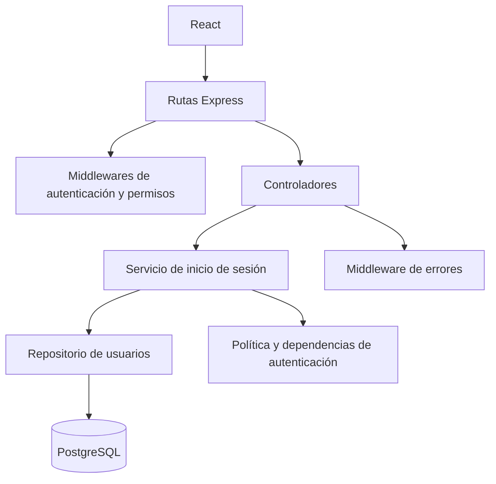

# Arquitectura y SOLID — Huellitas de Amor

Arquitectura cliente-servidor, monolito modular por capas. React presenta las vistas y llama a la API Express; PostgreSQL conserva los datos. No se introducen microservicios ni interfaces artificiales.

## Evidencias de SOLID
- SRP: controlador de login traduce HTTP; servicio coordina autenticación; repositorio consulta datos; política valida contraseñas.
- OCP: el servicio admite otras implementaciones de las tres dependencias sin cambiar el flujo; no significa que todo el sistema esté cerrado a modificaciones.
- LSP: no hay jerarquía de negocio que justifique una demostración de sustitución de subclases. Las dependencias alternativas deben respetar el contrato funcional.
- ISP: se inyectan tres funciones pequeñas, no una interfaz general de infraestructura.
- DIP: el caso de uso recibe consulta, comparación y emisión de token; no importa PostgreSQL ni JWT directamente. El controlador compone las implementaciones.

## Patrones y excepciones
Repository (consulta de usuario), Service Layer (login), middleware (cadena Express), inyección de dependencias por funciones. AppError representa errores esperados 400/401; el middleware traduce a HTTP y oculta detalles internos en fallos inesperados. Los controladores anteriores conservan sus propios manejadores para minimizar regresiones. No se afirma una migración integral a servicios y repositorios.

## Pruebas
Desde server: `node --test` y `node --test --experimental-test-coverage`. Pruebas unitarias independientes de BD. La cobertura resultante solo corresponde a módulos ejecutados, no a toda la aplicación. Probar manualmente los tres roles y recuperación, permisos y operaciones de cada módulo antes de integrar.
